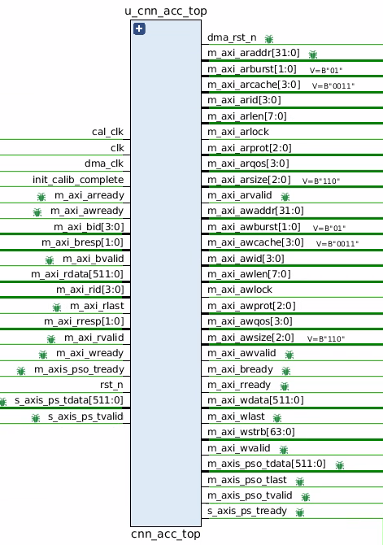
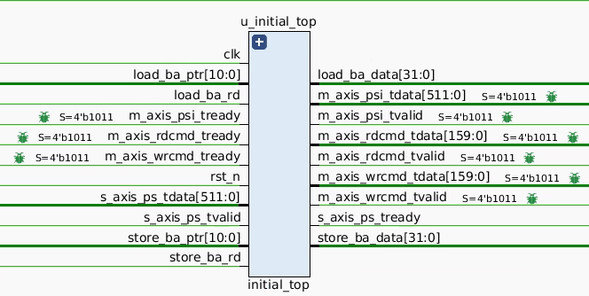
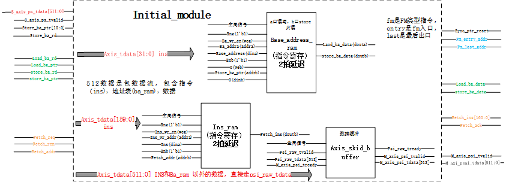
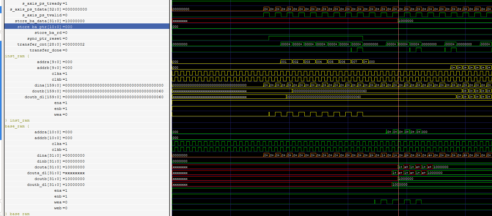
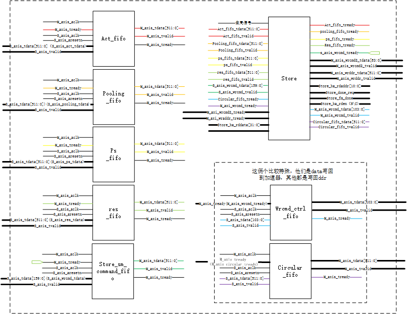
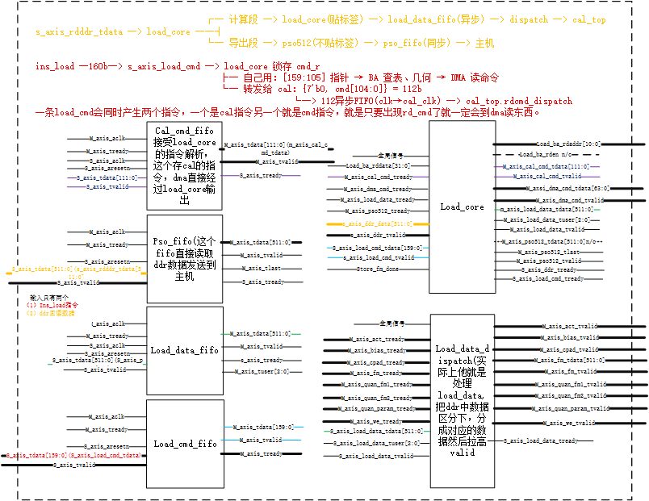
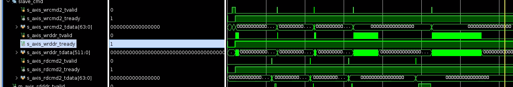
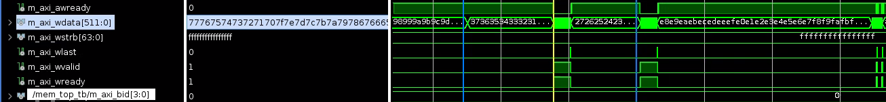

# 整体预览
## 指令集说明
### 读指令（rd_sm_cmd，160 bit）

> 来源：`rtl/define/rd_sm_cmd_define.v`。读指令驱动 load_top/DMA 从 DDR 搬运特征图与参数，同时携带本层计算所需的几何配置。位段规划：`[0:46]` 通用控制 → `[47:104]` 算子专用（按 model_sel 复用）→ `[105:159]` 指针（片内 RAM 基址索引）。

#### 1. 通用控制字段 [46:0]（所有算子共享）

| 字段 | 位段 [start+width-1 : start] | 位宽 | 说明 |
|---|---|---|---|
| `RD_RW_FLAG` | [0:0] | 1 | 读写标志（读指令固定为读） |
| `RD_MODEL_SEL` | [4:1] | 4 | 算子类型编码 |
| `RD_FM_CHANNEL_IN` | [16:5] | 12 | 输入特征图通道数 |
| `RD_FM_ROW_IN` | [28:17] | 12 | 输入特征图行数 |
| `RD_FM_COLUMN_IN` | [35:29] | 7 | 输入特征图列数 |
| `RD_FM_CHANNEL_OUT` | [41:36] | 6 | 输出通道数 |
| `RD_LAST_FM_OUT_COLUMN_VALID` | [46:42] | 5 | 末列有效位掩码 |

`model_sel` 算子编码：

| 编码 | 算子 |
|---|---|
| `4'b0000` | 卷积 CONV |
| `4'b0001` | 池化 POOLING |
| `4'b0010` | 残差加 RESADD |
| `4'b0011` | 上采样 UPSAMPLE |
| `4'b0100` | 通道拼接 CONCAT |
| `4'b0101` | 分割 SPLIT |
| `4'b0110` | 导出 EXPORT |

#### 2. 算子专用字段 [104:47]（按算子复用同一地址空间）

**2.1 卷积 CONV [104:47]**

| 字段 | 位段 | 位宽 | 说明 |
|---|---|---|---|
| `RD_CONV_KERNEL_SIZE_R` | [49:47] | 3 | 卷积核行数 |
| `RD_CONV_KERNEL_SIZE_C` | [52:50] | 3 | 卷积核列数 |
| `RD_CONV_STRIDE_R` | [54:53] | 2 | 行步长 |
| `RD_CONV_STRIDE_C` | [56:55] | 2 | 列步长 |
| `RD_CONV_PADDING_TOP/BOTTOM/RIGHT/LEFT` | [64:57] | 2×4 | 四向 padding |
| `RD_CONV_FM_OUT_ROW` | [76:65] | 12 | 输出行数 |
| `RD_CONV_FM_OUT_COL` | [83:77] | 7 | 输出列数 |
| `RD_CONV_CIRCULAR_PADDING_EN` | [84:84] | 1 | 循环 padding 使能 |
| `RD_CONV_CIRCULAR_PADDING_SEL` | [85:85] | 1 | 循环 padding 选择 |
| `RD_CONV_OP_TYPE` | [86:86] | 1 | 卷积算子子类型 |
| `RD_CONV_OUT_TYPE` | [87:87] | 1 | 输出数据类型 |
| `RD_CONV_RESERVE` | [104:88] | 17 | 保留 |

**2.2 池化 POOLING [104:47]**

| 字段 | 位段 | 位宽 | 说明 |
|---|---|---|---|
| `RD_POOL_KERNEL_SIZE_R/C` | [52:47] | 3+3 | 池化核行/列 |
| `RD_POOL_STRIDE_R/C` | [56:53] | 2+2 | 行/列步长 |
| `RD_POOL_PADDING_TOP/BOTTOM/RIGHT/LEFT` | [64:57] | 2×4 | 四向 padding |
| `RD_POOL_POOLING_TYPE` | [65:65] | 1 | 池化类型（max/avg） |
| `RD_POOL_CIRCULAR_PADDING` / `_SEL` | [67:66] | 1+1 | 循环 padding |
| `RD_POOL_RESERVE` | [104:68] | 37 | 保留 |

**2.3~2.7 其余算子**

| 算子 | 字段 | 位段 | 说明 |
|---|---|---|---|
| RESADD | `RD_RESADD_RESERVE` | [104:47] 58b | 全保留（几何用通用字段） |
| UPSAMPLE | `RD_UPSAMPLE_TYPE` | [47] 1b | 上采样类型 |
| CONCAT | `RD_CONCAT_TYPE` | [48:47] 2b | 拼接类型 |
| CONCAT | `RD_CONCAT_FM2/3/4_IN_CHANNEL` | [84:49] 12b×3 | 另外几个输入流的通道数 |
| SPLIT | `RD_SPLIT_CH_START` | [58:47] 12b | 起始通道 |
| SPLIT | `RD_SPLIT_CH_NUM` | [70:59] 12b | 分割通道数 |
| EXPORT | `RD_EXPORT_LAST` | [47] 1b | 是否最后一层 |
| EXPORT | `RD_EXPORT_OUT_TYPE` | [48] 1b | 输出数据类型 |

#### 3. 指针字段 [159:105]（片内 RAM 基址索引，11 bit/个）

通用指针（所有算子）：

| 字段 | 位段 | 说明 |
|---|---|---|
| `RD_BASE_ADDR_POINT_FM` | [115:105] | 特征图 FRAM 基址 |
| `RD_BASE_ADDR_POINT_QUAN` | [126:116] | 量化参数基址 |

卷积专用（与 RESADD/CONCAT/UPSAMPLE/SPLIT/EXPORT 的 FM2-FM4 指针**互为复用**）：

| 字段 | 位段 | 说明 |
|---|---|---|
| `RD_CONV_BASE_ADDR_POINT_WEIGHT` | [137:127] | 权重 WRAM 基址 |
| `RD_CONV_BASE_ADDR_POINT_BIAS` | [148:138] | 偏置基址 |
| `RD_CONV_BASE_ADDR_POINT_ACT` | [159:149] | 激活配置基址 |

复用关系：

| 字段 | 位段 | 卷积含义 | 多流算子含义 |
|---|---|---|---|
| [137:127] | 11b | WEIGHT 基址 | FM2 基址（RESADD/CONCAT/UPSAMPLE/SPLIT/EXPORT） |
| [148:138] | 11b | BIAS 基址 | FM3 基址 |
| [159:149] | 11b | ACT 基址 | FM4 基址 |

#### 4. 辅助宏

`RD_GET_FIELD(sig, start, width)` — 字段提取：`(sig >> start) & ((1<<width)-1)`。

### 写指令（wr_sm_cmd，160 bit）

> 来源：`rtl/define/wr_sm_cmd_define.v`。写指令驱动 store_top/DMA 把片内数据写回 DDR（或接收外部传入的权重/偏置等：`init_psi` 数据流的落存也由它控制）。位段规划：`[0:47]` 统一字段 → `[159:48]` 按"特征图 / 其他数据"两种分支复用。

#### 1. 统一字段 [47:0]（所有写指令共享）

| 字段 | 位段 | 位宽 | 说明 |
|---|---|---|---|
| `WR_RW_FLAG` | [0:0] | 1 | 读写标志（写指令固定为写） |
| `WR_DATA_ORIGIN` | [3:1] | 3 | 数据来源编码 |
| `WR_PS_DATA_TYPE` | [6:4] | 3 | 数据类型编码 |
| `WR_WR_LEN` | [36:7] | 30 | 写传输长度 |
| `WR_BASE_ADDR` | [47:37] | 11 | 片内 RAM 基址索引 |

`data_origin` 数据来源编码：

| 编码 | 来源 |
|---|---|
| `3'b000` | PS（外部主机下发的数据，如权重/偏置） |
| `3'b001` | ACTIVE（激活输出） |
| `3'b010` | RES（残差输出） |
| `3'b011` | POOLING（池化输出） |

`ps_data_type` 数据类型编码：

| 编码 | 类型 |
|---|---|
| `3'b000` | 权重 WEIGHT |
| `3'b001` | 偏置 BIAS |
| `3'b010` | 量化参数 QUAN |
| `3'b011` | 激活配置 ACT |
| `3'b100` | 特征图 FM |

#### 2. 分支字段 [159:48]（按 FM / OTHER 两种数据类型复用）

**2.1 特征图 FM 分支 [159:48]**（写回计算结果/特征图到 DDR）

| 字段 | 位段 | 位宽 | 说明 |
|---|---|---|---|
| `WR_FM_CHANNEL_END` | [59:48] | 12 | 通道终止索引 |
| `WR_FM_COLUMN_END` | [66:60] | 7 | 列终止索引 |
| `WR_FM_ROW_END` | [78:67] | 12 | 行终止索引 |
| `WR_FM_CHANNEL_START` | [84:79] | 6 | 通道起始索引 |
| `WR_FM_CHANNEL_TOTAL` | [96:85] | 12 | 通道总数 |
| `WR_FM_END_FLAG` | [97:97] | 1 | 是否最后一笔（层结束标志） |
| `WR_FM_OUT_TYPE` | [98:98] | 1 | 输出数据类型 |
| `WR_FM_RESERVE` | [159:99] | 61 | 保留 |

**2.2 其他数据 OTHER 分支 [159:48]**（权重/偏置/量化参数/激活配置的落存）

| 字段 | 位段 | 位宽 | 说明 |
|---|---|---|---|
| `WR_OTHER_INIT_DONE` | [48:48] | 1 | 参数初始化完成标志（收齐本层参数后置位） |
| `WR_KERNEL_C_IN_END` | [60:49] | 12 | 输入通道终止索引 |
| `WR_KERNEL_R_SIZE` | [63:61] | 3 | 卷积核行数 |
| `WR_KERNEL_C_SIZE` | [66:64] | 3 | 卷积核列数 |
| `WR_KERNEL_C_OUT_END` | [72:67] | 6 | 输出通道终止索引 |
| `WR_OTHER_RESERVE` | [159:73] | 87 | 保留 |

#### 3. 辅助宏

`WR_GET_FIELD(sig, start, width)` — 同 `RD_GET_FIELD`。

#### 读/写指令对照小结

| 维度 | 读指令 rd_sm_cmd | 写指令 wr_sm_cmd |
|---|---|---|
| 位宽 | 160 bit | 160 bit |
| 顶层分段 | 通用控制 / 算子专用 / 指针 | 统一字段 / FM-OTHER 分支 |
| 算子选择 | `model_sel` 7 种算子，专用字段复用 | 无算子字段，按数据类型 FM/OTHER 分支 |
| 数据来源 | IBM RAM 基址（DMA 读入方向） | `data_origin`（PS/激活/残差/池化） |
| 长度 | 无显式长度（由几何尺寸推导） | `wr_len` 30 bit 显式写长度 |
| 结束标志 | — | FM 分支 `end_flag`、OTHER 分支 `init_done` |

### 数据目的地标签（load_tag，TUSER 3 bit）

> 来源：`rtl/define/load_tag_define.vh`。load_top 从 DDR 读回的数据不按固定通路分发，而是由 `load_core_tagged` 给每笔数据打上 3 bit 的 TUSER 目的地标签，下游按标签路由到对应片内 RAM。

| 标签 | 值 | 目的地 |
|---|---|---|
| `LOAD_TAG_FM` | `3'd0` | 特征图 FRAM |
| `LOAD_TAG_CPAD` | `3'd1` | 循环 padding 缓冲 |
| `LOAD_TAG_WEIGHT` | `3'd2` | 权重 WRAM |
| `LOAD_TAG_BIAS` | `3'd3` | 偏置 |
| `LOAD_TAG_QUAN_PARAM` | `3'd4` | 量化参数 |
| `LOAD_TAG_ACT` | `3'd5` | 激活配置 |
| `LOAD_TAG_QUAN_FM1` | `3'd6` | 量化用特征图 1 |
| `LOAD_TAG_QUAN_FM2` | `3'd7` | 量化用特征图 2 |

配套位宽宏：

| 宏 | 值 | 含义 |
|---|---|---|
| `LOAD_RD_CMD_WIDTH` | 160 | 读指令位宽（= `RD_SM_CMD_WIDTH`） |
| `LOAD_DMA_CMD_WIDTH` | 64 | load 侧 DMA 命令位宽 |
| `LOAD_CAL_CMD_WIDTH` | 112 | 给 cal_top 的计算命令位宽（`load_cal_cmd_tdata[111:0]`） |
| `LOAD_DDR_DATA_WIDTH` | 512 | DDR 数据位宽 |
| `LOAD_BA_ADDR_WIDTH` / `LOAD_BA_DATA_WIDTH` | 11 / 32 | load 侧基址表（BA）读写端口 |
| `LOAD_TAG_WIDTH` | 3 | TUSER 标签位宽 |

> 注意：该文件头部注明是 "width draft for local refactor discussion"，部分宏为重构讨论期的临时定义，迁移回主线时应以工程正式宏为准。

### 整体工作流程

> 主机把「程序 + 地址表 + 模型参数 + 输入特征图」打包推进来，加速器**先全部落进 DDR**，再逐层读出计算、逐层写回 DDR，末层结果直接回主机。

```
主机 ──包流──> initial_top ─┬─ 指令 → ins_ram ──取指──┬─ 读指令 → load_top
                            │                        └─ 写指令 → store_top
                            ├─ 地址 → ba_ram ──查表──→ load/store（11bit 表项 → 32bit DDR 地址）
                            └─ 参数/特征图 → psi ──→ store_top ──DMA──> 【DDR】写入
                                                            ↑ 写指令告诉它：是什么、写到哪、多长

【DDR】──DMA读──> load_top（打 TUSER tag）──> cal_top 片内 RAM ──预取──> MAC
                                                                            ↓
                                                    结果 ──> store_top ──DMA──> 【DDR】
                                                    末层 EXPORT ──> 直接回主机
```

| 包 | 净荷 | 落点 |
|---|---|---|
| `INS` / `BA` | 指令 / 基地址 | `ins_ram` / `ba_ram`（供取指与查表） |
| `PARAM` / `FM` | 权重偏置量化激活 / 输入特征图 | 经 `psi` → store_top → **DDR** |

**分步时序（一帧的完整过程）：**

| 步 | 事件 | 硬件动作 |
|---|---|---|
| ① | 复位后 | `ins_load.fetch_req_r` 复位即 **1**；`initial_module` 在 IDLE，`tready = fetch_req` → 就绪等包 |
| ② | 主机发 **INS 包** | `IDLE→RECV_INS`；每拍低 160b **当拍直写** `ins_ram`（写地址自增）；同时记下 `fm_entry_addr`（最后一条 PS+FM 写指令）与 `fm_last_addr`（末条指令）。`fetch_ack` **不响应**——纯备料 |
| ③ | 主机发 **BA 包** | `RECV_BA`；每拍低 32b 直写 `ba_ram`。同样不触发取指 |
| ④ | 主机发 **PARAM 包头拍** | ★ **`fetch_ack` 脉冲** → `ins_load.work_r` 拉起，取指启动 |
| ⑤ | 取指进行 | `fetch_addr` 从 0 递增读 `ins_ram`（BMG 2 拍延迟，`ins_valid_r` 两级打拍对齐），按 `rw_flag` 分流：<br>· **写指令 → `wrcmd`** → store_top（IDLE 即收）<br>· **读指令 → `rdcmd`** → load_top，**被闸门挡住**，堆在 4 深 FIFO 里 |
| ⑥ | PARAM/FM 净荷到 | 4 拍 PARAM + 3 拍 FM 经 `psi` 流入 store_top；store_top 按写指令的 `wr_len` **逐条配对消费**（2+1+1 与 4 拍 PARAM 对齐，3 与 FM 对齐），按 `base_addr_ptr` 查 `ba_ram` 得 DDR 地址后写入 |
| ⑦ | FM 写完 | `fm_channel_end == fm_channel_total-1` → **`store_fm_done` 脉冲 → 开闸** |
| ⑧ | 逐层计算 | load_top 收下第一条计算指令（**消耗 token，闸门关**）→ 查表得地址 → DMA 读 DDR → 数据回来打 TUSER tag → cal_top 片内 RAM → 预取 → MAC → 量化/激活/池化/残差 → store_top → 写回 DDR → **又产生一个 token** → 放行下一层。<br>周而复始，层与层严格串行 |
| ⑨ | 末层 | `EXPORT` 算子结果**不经 DDR 直接回主机**（`m_axis_pso`），并收回 token |
| ⑩ | 第二帧 | 主机**只发 FM 包** → `fetch_ack` → 取指从 `fm_entry_addr` 起重入（参数类指令不再执行） |

> 第 ⑤~⑧ 步期间读指令被挡住，是**设计内的停顿**：FIFO 堆满即耗尽 credit，取指自动暂停，等闸门开。不丢指令、不报错。

**关键信号与代码位置：**

| 机制 | 表达式 | 位置 |
|---|---|---|
| 启动扳机 | `fetch_ack = IDLE & fetch_req & (param_en \| fm_en)` | [initial_module.v:201](../initial_top/initial_module.v#L201) |
| 写指令驱动收数据 | `ps_fifo_tready = (curr_state == STORE_PS) & output_paths_ready` | [store.v:402](../store_top/store.v#L402) |
| token 产生 | `store_fm_done = store_is_write_fm & … & (fm_channel_end == fm_channel_total-1)` | [store.v:960](../store_top/store.v#L960) |
| 层间闸门 | `s_axis_load_cmd_tready = … & fm_done_latch & …` | [load_core_tagged.v:112-118](../load_top/load_core_tagged.v#L112-L118) |

```
输入FM写DDR ──token──> L1计算 ──结果写DDR──token──> L2计算 ──> ... ──> 末层EXPORT
```

**两条硬性约束：**

- **指令顺序**：PS 写指令必须排在计算指令之前。反了就死锁——计算指令堵住 rdcmd FIFO 与 credit，写指令永远取不到，`store_fm_done` 永不产生，闸门永不开。（tb 变异测试已实证：去掉 `rw_flag` 判定使 `fm_entry_addr` 被污染，第二帧直接死锁）
- **每帧重入**：循环体 `[fm_entry_addr, fm_last_addr]` 每帧重跑，体外的参数写指令只跑一次 → **权重常驻，第二帧只重传 FM**。重入首条指令正是 FM 上传写指令，恰好是处理本帧数据所需要的那条。

# 模块设计
## acc_top

### 端口说明

> 来源：`rtl/top/cnn_acc_top.v`。加速器核顶层（平台无关层），SRIO/PCIe 等平台相关部分全部在 `vpx640_acc_top` 一层，核本身不感知。

本模块对外有**两类 AXI 接口，职责完全不同，不要混为一谈**：

| 接口族 | 端口 | 有无地址 | 职责 |
|---|---|---|---|
| **AXI4-Stream（AXIS）** | `s_axis_ps` / `m_axis_pso` | 无 | 与主机之间的数据流：收包（指令 + 参数 + 特征图）、回结果。核内部 load/store/cal 之间的中间结果搬运也全部走 AXIS |
| **AXI4-Full（AXI4）** | `m_axi_*` | 有 | 与 DDR 的读写访存：特征图/权重/结果的取回与落存 |

外加**时钟与复位**一组。下面按"接口族 → 输入/输出"分开列出。

<font color=red> 有必要说明，这个模块有两路axi数据流，一条是axi-stream,负责中间计算结果的转移，axi4-full负责ddr等通信</font>

#### 1. 参数

| 参数 | 默认值 | 说明 |
|---|---|---|
| `AXI_ADDR_WIDTH` | 32 | AXI4 地址位宽 |
| `AXI_DATA_WIDTH` | `DMA_AXI_SELECTED_DATA_WIDTH` | 由 `dma_axi4_defs.vh` 选择（本工程 512） |
| `AXI_ID_WIDTH` | 4 | AXI4 ID 位宽 |
| `AXI_STRB_WIDTH` | `DMA_AXI_SELECTED_STRB_WIDTH` | 字节选通位宽（本工程 64） |

#### 2. AXI4-Stream 接口（主机包流，512b）

> AXIS 无地址、单向、以流/包为单位传递。本模块有两个 AXIS 端口：`s_axis_ps`（从机，收主机包流）和 `m_axis_pso`（主机，回结果）。

**2.1 输入端口**

| 端口 | 位宽 | 说明 |
|---|---|---|
| `s_axis_ps_tdata` | 512 | 包流数据（包头 + INS/BA/PARAM/FM 净荷） |
| `s_axis_ps_tvalid` | 1 | 输入数据有效 |
| `m_axis_pso_tready` | 1 | 结果输出通道的下游就绪（输出通道的**输入**侧握手） |

**2.2 输出端口**

| 端口 | 位宽 | 说明 |
|---|---|---|
| `s_axis_ps_tready` | 1 | 输入通道的就绪**输出**（由 `fetch_req` 与状态机决定） |
| `m_axis_pso_tdata` | 512 | EXPORT 算子结果 |
| `m_axis_pso_tvalid` | 1 | 输出数据有效 |
| `m_axis_pso_tlast` | 1 | 帧尾标志（输出方向带 `tlast`） |

> **方向易错点**：`tready` 永远指向流的上游——`s_axis_ps_tready` 是**输出端口**（本模块告诉主机"我能收"），`m_axis_pso_tready` 是**输入端口**（下游告诉本模块"我能收"）。两者都不是数据方向。
>
> 信号裁剪：输入通道只用 `tdata/tvalid/tready`，无 `tkeep`（512b 整拍有效）、无 `tlast`（包边界由包头 `len` 自定界）、无 `tuser`；输出通道多一根 `tlast` 标帧尾。

#### 3. AXI4-Full 接口（主存，512/32/4）

> AXI4-Full 带地址通道、突发语义与写响应，负责核与 DDR 之间的读写访存（`m_axi_*`）。与 AXIS 的本质区别：**有地址、有响应、按突发传输**。
>
> 本模块是 **Master**（地址由本模块给出），对端 MIG 是 Slave。五条通道**各自独立握手**、互不阻塞，故按下表按通道分类（方向列 `out`=本模块驱动，`in`=对端驱动）。

**3.1 AW（写地址通道）**

| 端口 | 方向 | 位宽 | 说明 |
|---|---|---|---|
| `m_axi_awid` | out | 4 | 写地址 ID |
| `m_axi_awaddr` | out | 32 | 写地址 |
| `m_axi_awlen` | out | 8 | 写突发长度：awlen+1
| `m_axi_awsize` | out | 3 | 写突发大小（512b → `3'b110`） |
| `m_axi_awburst` | out | 2 | 写突发类型 |
| `m_axi_awlock` | out | 1 | 写锁定 |
| `m_axi_awcache` | out | 4 | 写 cache 属性 |
| `m_axi_awprot` | out | 3 | 写保护属性 |
| `m_axi_awqos` | out | 4 | 写 QoS |
| `m_axi_awvalid` | out | 1 | 写地址有效 |
| `m_axi_awready` | in | 1 | 写地址就绪 |

**3.2 W（写数据通道）**

| 端口 | 方向 | 位宽 | 说明 |
|---|---|---|---|
| `m_axi_wdata` | out | 512 | 写数据 |
| `m_axi_wstrb` | out | 64 | 写字节选通 |
| `m_axi_wlast` | out | 1 | 写末拍 |
| `m_axi_wvalid` | out | 1 | 写数据有效 |
| `m_axi_wready` | in | 1 | 写数据就绪 |

**3.3 B（写响应通道）**

| 端口 | 方向 | 位宽 | 说明 |
|---|---|---|---|
| `m_axi_bid` | in | 4 | 写响应 ID |
| `m_axi_bresp` | in | 2 | 写响应（`OKAY`/`SLVERR`…） |
| `m_axi_bvalid` | in | 1 | 写响应有效 |
| `m_axi_bready` | out | 1 | 写响应就绪 |

**3.4 AR（读地址通道）**

| 端口 | 方向 | 位宽 | 说明 |
|---|---|---|---|
| `m_axi_arid` | out | 4 | 读地址 ID |
| `m_axi_araddr` | out | 32 | 读地址 |
| `m_axi_arlen` | out | 8 | 读突发长度（beat 数 - 1） |
| `m_axi_arsize` | out | 3 | 读突发大小（512b → `3'b110`） |
| `m_axi_arburst` | out | 2 | 读突发类型 |
| `m_axi_arlock` | out | 1 | 读锁定 |
| `m_axi_arcache` | out | 4 | 读 cache 属性 |
| `m_axi_arprot` | out | 3 | 读保护属性 |
| `m_axi_arqos` | out | 4 | 读 QoS |
| `m_axi_arvalid` | out | 1 | 读地址有效 |
| `m_axi_arready` | in | 1 | 读地址就绪 |

**3.5 R（读数据通道）**

| 端口 | 方向 | 位宽 | 说明 |
|---|---|---|---|
| `m_axi_rid` | in | 4 | 读数据 ID |
| `m_axi_rdata` | in | 512 | 读数据 |
| `m_axi_rresp` | in | 2 | 读响应 |
| `m_axi_rlast` | in | 1 | 读末拍 |
| `m_axi_rvalid` | in | 1 | 读数据有效 |
| `m_axi_rready` | out | 1 | 读数据就绪 |

> 五通道对应关系：**写 = AW + W + B**（地址 → 数据 → 响应），**读 = AR + R**（地址 → 数据，响应随数据通道返回）。
> 主口规格：512 数据位宽 / 32 地址位宽 / 4 ID 位宽（`wstrb` 64 位），全链路无位宽转换，直连 MIG。

#### 4. 时钟与复位

**4.1 输入端口**

| 端口 | 说明 |
|---|---|
| `clk` | UI 域时钟（200 MHz，MIG `ui_clk`），AXI4-Full 主口所在域 |
| `cal_clk` | 计算域时钟（160 MHz，MIG `ui_addn_clk_0`），`cal_top` 专用 |
| `dma_clk` | 搬运域时钟（100 MHz，MIG `ui_addn_clk_1`），initial/load/store + DMA 用户侧 |
| `rst_n` | UI 域复位（低有效），作为 dma/cal 域的 `ext_reset_in` |
| `init_calib_complete` | DDR3 校准完成（UI 域），作 `aux_reset_in` 闸门 |

**4.2 输出端口**

| 端口 | 说明 |
|---|---|
| `dma_rst_n` | DMA 域复位（低有效）**导出**，供顶层传输通路（SRIO rx/tx 的 dma 侧）共用同一复位 |

#### 5. 内部结构（例化关系）

| 子模块 | 时钟域 | 职责 |
|---|---|---|
| `initial_top` | dma_clk | PS 包解析：写 `ins_ram`/`ba_ram`，PARAM/FM 转发 |
| `load_top` | dma_clk（+cal_clk 侧输出） | 读指令消费、DDR 读数据分发（带 tag）、EXPORT 结果输出 |
| `cal_top` | cal_clk | 计算核：卷积/池化/激活/残差/量化 |
| `store_top` | dma_clk（+cal_clk 侧输入） | 计算结果收集、写指令消费、写回 DDR |
| `dma_axi4_master` | clk(ui) / dma_clk | AXI4 主控，读写 DDR（`usr_clk = dma_clk` 为命令/数据用户侧） |
| `rst_dma_clk` | dma_clk | proc_sys_reset：`ext=rst_n`、`aux=init_calib_complete` |
| `rst_cal_clk` | cal_clk | 同上，产生 `cal_rst_n` |

#### 6. 要点

- **三域复位同源同闸门**：dma/cal 域复位均由 proc_sys_reset 产生，`ext_reset_in = rst_n`（已含 POR/MMCM 锁），`aux_reset_in = init_calib_complete`——**DDR 校准完成前核不出复位、不会提前访存**；释放由 IP 内部同步（异步置位/同步释放），链上无手写组合逻辑。
- **AXI 全链路 512b 直连**：核的 AXI 主口直接对接 MIG 512b 从口，无位宽转换（20260814 去除 axi_dw 方案）。
- **平台无关性**：换 PCIe/MIPI 板卡时，只需替换 `vpx640_acc_top` 中的 SRIO 桥，本模块端口与内部结构可整块搬运。

**数据流**
```
DDR ──AXI4-Full 读──> load_top ──AXIS──> cal_top ──AXIS──> store_top ──AXI4-Full 写──> DDR
     ↑ 搬运工            ↑ 语义开始在这里      ↑ 算           ↑ 收结果
```
## initial_top 模块


### 端口说明

> 来源：`rtl/initial_top/initial_top.v`。加速器核的最上游：把主机包流拆成**数据**（转发给 store_top 落存）和**指令**（存入 ins_ram 供取指执行），并维护指令 RAM 与基地址表。本模块内部只有两个子模块，自身无逻辑，是纯例化壳。
>
> 对外有两类 AXIS 端口（收包 / 发指令 / 转发数据）+ 一组内部互联接口（取指、BA RAM 访存）。

#### 1. AXI4-Stream 接口

**1.1 输入端口**

| 端口 | 位宽 | 说明 |
|---|---|---|
| `s_axis_ps_tdata` | 512 | 主机包流数据（包头 + INS/BA/PARAM/FM 净荷） |
| `s_axis_ps_tvalid` | 1 | 输入数据有效 |
| `m_axis_rdcmd_tready` | 1 | 读指令通道的下游就绪 |
| `m_axis_wrcmd_tready` | 1 | 写指令通道的下游就绪 |
| `m_axis_psi_tready` | 1 | 数据转发通道的下游就绪 |

**1.2 输出端口**

| 端口 | 位宽 | 说明 |
|---|---|---|
| `s_axis_ps_tready` | 1 | 包流就绪**输出**（由 `fetch_req` 与状态机决定） |
| `m_axis_rdcmd_tdata` | 160 | 读指令（`RD_SM_CMD_WIDTH`）→ load_top |
| `m_axis_rdcmd_tvalid` | 1 | 读指令有效 |
| `m_axis_wrcmd_tdata` | 160 | 写指令（`WR_SM_CMD_WIDTH`）→ store_top |
| `m_axis_wrcmd_tvalid` | 1 | 写指令有效 |
| `m_axis_psi_tdata` | 512 | PARAM/FM 净荷直通输出 → store_top |
| `m_axis_psi_tvalid` | 1 | 转发数据有效 |

#### 2. 内部互联接口

**2.1 取指接口（ins_load ↔ initial_module，8 根线）**

| 端口 | 方向 | 位宽 | 说明 |
|---|---|---|---|
| `fetch_req` | ins_load → initial_module | 1 | 取指请求 / "要下一包" |
| `fetch_ack` | initial_module → ins_load | 1 | 取指应答（IDLE 且包类型为 PARAM/FM 时拉高） |
| `fetch_ren` | ins_load → initial_module | 1 | 取指读使能 |
| `fetch_addr` | ins_load → initial_module | 10 | 取指读地址（ins_ram B 口） |
| `fetch_ins` | initial_module → ins_load | 160 | 取指指令数据（BMG `DO_REG=1`，**2 拍后有效**） |
| `sync_ptr_reset` | initial_module → ins_load | 1 | 下载指令期间强制指针复位（`INIT_RECV_INS` 期间有效） |
| `fm_entry_addr` | initial_module → ins_load | 10 | 模型重入指针（FM 上传指令地址） |
| `fm_last_addr` | initial_module → ins_load | 10 | 模型结束指针（最后一条指令地址） |

**2.2 基地址 RAM 访存端口（读方向，供 load/store 查表）**

| 端口 | 方向 | 位宽 | 说明 |
|---|---|---|---|
| `load_ba_rd` | in | 1 | load 侧读使能 |
| `load_ba_ptr` | in | 11 | load 侧读指针（ba_ram A 口） |
| `load_ba_data` | out | 32 | load 侧读数据 |
| `store_ba_rd` | in | 1 | store 侧读使能 |
| `store_ba_ptr` | in | 11 | store 侧读指针（ba_ram B 口） |
| `store_ba_data` | out | 32 | store 侧读数据 |

#### 3. 其他信号

| 端口 | 方向 | 说明 |
|---|---|---|
| `clk` | in | 搬运域时钟（顶层实际接 `dma_clk`；子模块注释写的是 ui_clk，**以顶层连接为准**） |
| `rst_n` | in | 复位（低有效） |


| 子模块 | 职责 |
|---|---|
| `initial_module` | 数据面：PS 包解析、写 `ins_ram`/`ba_ram`、PARAM/FM 转发 |
| `ins_load` | 控制面：取指循环、按 `rw_flag` 分流读写指令 |

#### 4. initial 模块主要作用
将PS的512 包分解成为下游使用的三组指令。
```
             ┌─── 第一组：AXIS（跨边界，有握手，流）
             │      s_axis_ps 进 / rdcmd·wrcmd·psi 出
initial_top ─┼─── 第二组：BA 查表口（跨边界，无握手，读）
             │      load_ba_* / store_ba_*  → load_top / store_top
             └─── 第三组：取指接口（模块内，无握手，读+配置）
                    ins_load ↔ initial_module
```
这里的信号分为三组，他们都是axi-stream,但是注意到一组特殊型号，**load和store**,实际上它是用来查表翻译的，11bit 不足以代表真实的ddr地址范围，因此加入他。随后经过store_top和load_top内部的译码转换为真实的ddr地址.可见store.v代码中WR_BASE_ADDR_START。
### ins_load

> 来源：`rtl/initial_top/ins_load.v`。取指与指令分发：从 `ins_ram` 逐拍取出 160b 指令，按 `rw_flag` 分流成读/写两条流。

| 端口 | 方向 | 位宽 | 说明 |
|---|---|---|---|
| `clk` / `rst_n` | in | 1 | 时钟 / 复位（低有效） |
| `fetch_req` | out 


| 1 | 取指请求 |

| `fetch_ack` | in | 1 | 取指应答 |
| `fetch_ren` | out | 1 | 取指读使能（受 credit 门控） |
| `fetch_addr` | out | 10 | 取指读地址 |
| `fetch_ins` | in | 160 | 取指指令数据（2 拍延迟） |
| `sync_ptr_reset` | in | 1 | 强制指针复位 |
| `fm_entry_addr` | in | 10 | 重入指针（回卷目标） |
| `fm_last_addr` | in | 10 | 结束指针（取指上界） |
| `m_axis_wrcmd_tdata` | out | 160 | 写指令 → store_top |
| `m_axis_wrcmd_tvalid` | out | 1 | 写指令有效 |
| `m_axis_wrcmd_tready` | in | 1 | 写指令就绪 |
| `m_axis_rdcmd_tdata` | out | 160 | 读指令 → load_top |
| `m_axis_rdcmd_tvalid` | out | 1 | 读指令有效 |
| `m_axis_rdcmd_tready` | in | 1 | 读指令就绪 |

要点：4 个 credit 流控（发读请求 +1、指令出 FIFO -1），正好覆盖 2 拍 RAM 延迟 + 2 拍队列存储；**source ready 只看本地寄存器占用，不依赖下游 ready**。两条指令 FIFO 各深 4。

### initial_module

这个模块主要是接受主机发送的包文件，然后识别拆分，对应三种类型，ins指令存入ins_ram,ba ram 表存入 base_address_ram, 其他数据直接进缓存在输出，他还提供了两个特殊信号fm_entry_addr和fm_last_addr.这个循环是通过ins_load 实现的，这个模块的取值使能来自他，看代码就会看到fetch_addr和fetch_done信号与他相关。
```
ins_ram 地址空间
  0                                                     fm_last_addr
  ├──────────────────────────────────────────────────────────┤
  │ 权重上传 │ 偏置上传 │ 量化上传 │ ... │ FM上传 │ 计算指令... │
  └──────────────────────────────────────┴──────────────────┘
                                        ↑                 ↑
                                   fm_entry_addr     fm_last_addr
                                        └──── 循环体 ────┘
                                        （每次跑完回卷到这里）

```

#### PS 包说明（512 bit 包流如何自定界与分类）

`s_axis_ps` 上**没有 `tlast`**，包边界不靠流信号、而靠**每包首拍（包头拍）低 32 bit 的带内包头**自定界。包结构见 `rtl/define/cnn_acc_common_defs.vh`：

| 包头字段 | 位段 | 位宽 | 说明 |
|---|---|---|---|
| `INIT_DATA_LEN` | `[28:0]` | 29 | 有效负载 **beat 数**（不含包头拍本身） |
| `INIT_DATA_TYPE` | `[31:29]` | 3 | 包类型编码 |
| 高位 `[511:32]` | — | 480 | 包头拍固定为 0，不用 |

`INIT_DATA_TYPE` 四种编码（`cnn_acc_common_defs.vh`）：

| 编码 | 类别 | 净荷含义 | `len` 语义 | 解析后的去向 |
|---|---|---|---|---|
| `3'd0` | `INS` | 指令包 | 指令条数 | 每拍低 160b 一条读/写指令，当拍直写 `ins_ram` |
| `3'd1` | `BA` | 基地址表包 | 地址个数 | 每拍低 32b 一个基地址，当拍直写 `base_address_ram`（`ba_ram`） |
| `3'd2` | `PARAM` | 参数包（权重/偏置/量化/激活配置） | 512b 字数 | 整字直通 `psi` 转发给 `store_top` |
| `3'd3` | `FM` | 特征图上传包 | 512b 字数 | 整字直通 `psi` 转发给 `store_top` |

**定界与分类的实现（`initial_module.v`）**

```verilog
// 包头总是从 data 线的低位取——无论当前处于什么状态
assign data_type_decode = s_axis_ps_tdata[`INIT_DATA_TYPE_START +: `INIT_DATA_TYPE_WIDTH];  // [31:29]
assign data_len_decode  = s_axis_ps_tdata[`INIT_DATA_LEN_START  +: `INIT_DATA_LEN_WIDTH ];  // [28:0]
```

1. **锁存包头**：处于非传输态（`!is_transfer_state`）时的握手拍就是包头拍，把 `type`/`len` 锁进寄存器 `data_type`/`data_len`（[initial_module.v:165-174](../initial_top/initial_module.v#L165-L174)）。
2. **类型译码**：`data_type_decode` 与四个宏比较，得到 `ins_en`/`ba_en`/`param_en`/`fm_en` 四个跳转使能。
3. **分流跳转**：`INIT_IDLE` 态下依据 `fetch_req` 与上述使能跳到对应净荷接收态——`INS→RECV_INS`、`BA→RECV_BA`、`PARAM→RECV_PARAM`、`FM→RECV_FM`（[initial_module.v:105-110](../initial_top/initial_module.v#L105-L110)）。
4. **净荷计数**：`transfer_cnt` 每笔有效握手 +1，`transfer_done = (transfer_cnt == data_len - 1) & handshake` 即为**包尾**——这就是没有 `tlast` 时的定界方式。收满即回 `INIT_IDLE` 等下个包头拍。

**为什么包头拍固定从低位取？** 因为包头拍的高位恒 0，所以 `tdata[31:29]`/`tdata[28:0]` 在整个包内始终是有效的；只有靠 `is_transfer_state` 区分"这是包头拍"还是"这是净荷拍"——包头拍锁存、净荷拍按类型消费。

**一个必须注意的坑：`INS` 包和 `WR` 指令字段对齐。** `INS` 包的每拍低 160b 是一条**写指令 `wr_sm_cmd`**（读方向用 `rw_flag` 区分），所以指令里的字段位段和 `wr_sm_cmd_define.v` 完全对齐：

| 写指令字段 | 位段 | 用途 |
|---|---|---|
| `WR_RW_FLAG` | `[0]` | 读写标志，`ins_load` 据此分流读/写指令 |
| `WR_DATA_ORIGIN` | `[3:1]` | 数据来源（`000`=PS / `001`=ACTIVE / `010`=RES / `011`=POOLING） |
| `WR_PS_DATA_TYPE` | `[6:4]` | 数据类型（`000`=WEIGHT / `001`=BIAS / `010`=QUAN / `011`=ACT / `100`=FM） |

`initial_module` 用指令里的 `origin`/`ps_data_type` 来判定"这条指令是不是 FM 上传"，从而更新重入指针：

```verilog
assign data_origin  = ins[`WR_DATA_ORIGIN_START   +: `WR_DATA_ORIGIN_WIDTH];   // ins[3:1]
assign ps_data_type = ins[`WR_PS_DATA_TYPE_START  +: `WR_PS_DATA_TYPE_WIDTH];  // ins[6:4]
// fm_entry_addr 更新：必须同时卡 rw_flag（2026-08-05 修复）
else if (ins_wr_en & ins[`WR_RW_FLAG_START] & (data_origin == `DATA_ORIGIN_PS)
                                            & (ps_data_type == `PS_DATA_TYPE_FM))
    fm_entry_addr <= ins_wr_addr;
```

`WR_RW_FLAG` 不卡会出事：**读指令的字段会混叠成"看起来像 FM 上传"**——CONV 的 `model_sel=4'b0000` 恰好撞上 `origin=PS`，`channel_in` 低位恰好撞上 `type=FM`，于是 `fm_entry_addr` 被读指令地址误覆盖，导致 FM-only 重入时跳过 FM 上传（见 [initial_module.v:243-248](../initial_top/initial_module.v#L243-L248) 的修复注释）。

**包类型收尾行为不同**（决定 `tready` 时序）：`INS`/`BA` 收完即回 `INIT_IDLE`；`PARAM`/`FM` 收完先进 `WAIT_TRANS` 再进 `WAIT_INFER`，等 `ins_load` 取指请求（`fetch_req`）来了才回 `INIT_IDLE` 接下一包——所以 `s_axis_ps_tready` 在 `WAIT_INFER` 态是 0（[initial_module.v:189-192](../initial_top/initial_module.v#L189-L192)），此时 PS 侧被反压。

> 来源：`rtl/initial_top/initial_module.v`、`rtl/define/cnn_acc_common_defs.vh`、`rtl/define/wr_sm_cmd_define.v`。

| 端口 | 方向 | 位宽 | 说明 |
|---|---|---|---|
| `clk` / `rst_n` | in | 1 | 时钟 / 复位（低有效） |
| `s_axis_ps_tdata` | in | 512 | 主机包流数据 |
| `s_axis_ps_tvalid` | in | 1 | 输入有效 |
| `s_axis_ps_tready` | out | 1 | 就绪输出（`fetch_req` + 状态机决定） |
| `fetch_req` | in | 1 | 取指请求 |
| `fetch_ack` | out | 1 | 取指应答 |
| `fetch_ren` | in | 1 | 取指读使能 |
| `fetch_addr` | in | 10 | 取指读地址 |
| `fetch_ins` | out | 160 | 取指指令数据 |
| `sync_ptr_reset` | out | 1 | 强制指针复位 |
| `fm_entry_addr` | out | 10 | 模型重入指针 |
| `fm_last_addr` | out | 10 | 模型结束指针 |
| `load_ba_rd` / `load_ba_ptr` | in | 1 / 11 | load 侧 BA 读使能 / 指针 |
| `load_ba_data` | out | 32 | load 侧 BA 读数据 |
| `store_ba_rd` / `store_ba_ptr` | in | 1 / 11 | store 侧 BA 读使能 / 指针 |
| `store_ba_data` | out | 32 | store 侧 BA 读数据 |
| `m_axis_psi_tdata` | out | 512 | PARAM/FM 净荷转发 |
| `m_axis_psi_tvalid` | out | 1 | 转发数据有效 |
| `m_axis_psi_tready` | in | 1 | 转发数据就绪 |

要点：包头 `[31:29]=type`、`[28:0]=len`；INS 拍低 160b 当拍直写 `ins_ram`，BA 拍低 32b 当拍直写 `ba_ram`，PARAM/FM 整字直通 skid。`fm_entry_addr` 判定**必须卡 `rw_flag`**（否则读指令字段混叠会写坏重入指针，见 2026-08-05 修复注释）。

### 仿真分析
> [!Note] 仿真实现ps包发送（后面修改了仿真，不过ins和ba这部分原理都一样的）
```
send_packet(TYPE_INS,   N_INS);      // 8 条指令
send_packet(TYPE_BA,    N_BA);       // 4 个基地址
```
首先ps 发送 ins包指令，全部写入到ins_ram中，随后发送Ba指令，基地址存入base_address_ram中
但这两个发送完成后，我们发送FM和PARAM包。
```
send_packet(TYPE_PARAM, LEN_PARAM);  // 4 拍参数（包头拍触发 fetch_ack）
send_packet(TYPE_FM,    LEN_FM);     // 3 拍输入特征图
```
当他们发送开始，就意味程序启动了，这里的指令都是直通store_top这个模块的。
看一下前面整体预览/整体工作流程/ 。**下面发送的param结合wrcmd全部先写入ddr中。**

## store_top 模块

### 端口说明

> 来源：`rtl/store_top/store_top.v` + `store.v`。加速器的**写回出口**：把 4 类数据（主机参数 / 激活 / 池化 / 残差）按写指令落到 DDR，并产生层间 token（`store_fm_done`）。本模块是 5 个 FIFO + 1 个 `store` 的封装，自身无逻辑。
>
> 与 `initial_top` 的分工：initial 负责"把指令和数据**送出去**"，store_top 负责"把数据**按指令落到 DDR**"。

#### 1. AXI4-Stream 接口

**1.1 输入端口**

| 端口 | 位宽 | 时钟域 | 说明 |
|---|---|---|---|
| `s_axis_wrcmd_tdata` / `tvalid` | 160 / 1 | clk | 写指令（`WR_SM_CMD_WIDTH`），来自 `ins_load` |
| `s_axis_ps_tdata` / `tvalid` | 512 / 1 | clk | 主机参数 / 输入特征图，来自 `initial_top` 的 `psi` |
| `s_axis_act_tdata` / `tvalid` | 512 / 1 | **cal_clk** | 激活算子输出（卷积 / split 等层的输出） |
| `s_axis_pooling_tdata` / `tvalid` | 512 / 1 | **cal_clk** | 池化算子输出 |
| `s_axis_res_tdata` / `tvalid` | 512 / 1 | **cal_clk** | 残差模块输出（残差加 / 上采样 / 通道拼接） |
| `m_axis_wrcmd2_tready` | 1 | clk | 二级写命令的下游就绪（DMA） |
| `m_axis_wrddr_tready` | 1 | clk | DDR 写数据的下游就绪（DMA） |
| `m_axis_circular_tready` | 1 | **cal_clk** | 循环 padding 数据的下游就绪（cal_top） |
| `m_axis_wrcmd_tready` | 1 | **cal_clk** | 循环 padding 写指令的下游就绪（cal_top） |
| `store_done_ack` | 1 | cal_clk | "特征图写回完成"的应答（来自 cal_top，2 级同步进 clk 域） |
| `store_ba_rddata` | 32 | clk | BA 表读回的 32bit DDR 地址 |

**1.2 输出端口**

| 端口 | 位宽 | 时钟域 | 说明 |
|---|---|---|---|
| `m_axis_wrcmd2_tdata` / `tvalid` | 64 / 1 | clk | **二级写命令** = `{32b DDR 地址, 32b 长度}` → DMA |
| `m_axis_wrddr_tdata` / `tvalid` | 512 / 1 | clk | 要写往 DDR 的数据 → DMA |
| `m_axis_circular_tdata` / `tvalid` | 512 / 1 | **cal_clk** | 循环 padding 数据 → cal_top（供下一层用） |
| `m_axis_wrcmd_tdata` / `tvalid` | 104 / 1 | **cal_clk** | 循环 padding 写指令控制字段 → cal_top |
| `store_done_req` | 1 | clk | "特征图写回完成"请求 → cal_top |
| `store_fm_done` | 1 | clk | **层间 token** → `load_top`（开闸放行计算指令） |
| `store_ba_rden` | 1 | clk | BA 表读使能（驱动 `ba_ram` B 口） |
| `store_ba_rdaddr` | 11 | clk | BA 表项号（取自写指令 `WR_BASE_ADDR`） |
| 四路 `*_tready` | 1 | — | 对应 4 条输入流的就绪（本模块输出） |

#### 2. 时钟与复位

| 端口 | 说明 |
|---|---|
| `clk` | 搬运域（顶层接 `dma_clk`，100 MHz）。写指令、PS 数据、DMA 命令与数据都在此域 |
| `cal_clk` | 计算域（160 MHz）。三类计算结果（act/pooling/res）由此域写入，circular/wrcmd 由此域读出 |
| `rst_n` | 复位（低有效） |

#### 3. 内部结构（例化关系）

| 子模块 | 类型 | 作用 |
|---|---|---|
| `u_store_sm_command_fifo` | 160b **同步** | 写指令缓冲（clk 域） |
| `u_act_fifo` / `u_pooling_fifo` / `u_res_fifo` | 512b **异步** | cal_clk → clk，三类计算结果跨域 |
| `u_ps_fifo` | 512b **同步** | 主机参数 / 特征图缓冲（clk 域） |
| `store u_store` | — | 核心逻辑：写指令消费 + 4 路选通 + DMA 命令产出 |
| `u_circular_fifo` | 512b **异步** | clk → cal_clk，循环 padding 数据回吐给 cal_top |
| `u_wrcmd_ctrl_fifo` | 104b **异步** | clk → cal_clk，循环 padding 写指令回吐 |

> 一眼看出 store_top 的本质：**4 类数据各走一条 FIFO，进到 clk 域后由 `store` 按指令选通到同一个写通路**。

#### 4. 要点

- **4 类数据复用一条写通路**：`ps` / `act` / `pooling` / `res` 四条流由写指令的 `data_origin` 选通（[store.v:388-395](../store_top/store.v#L388-L395)），共用 `m_axis_wrddr`。
- **一条写指令 = 一次 BA 查表 + 一批数据**：`store_ba_rden/rdaddr` 驱动 B 口，2 拍后锁存 `store_ba_rddata`（`GET_BASE_ADDR → BA_WAIT → INIT` 三态）。
- **层间 token**：`store_fm_done` 只在"写特征图 + 最后一通道"时脉冲一次（[store.v:960](../store_top/store.v#L960)）→ load_top 开闸。
- **`store_done_req/ack` 是跨域握手**（clk ↔ cal_clk，ack 侧 2 级同步寄存器），语义是"这层结果已全部落 DDR"，供 cal_top 释放资源 / 推进下一层。

### store

> 来源：`rtl/store_top/store.v`（965 行）。核心逻辑，含**两个独立状态机**（别混）。

#### 端口

| 端口 | 方向 | 位宽 | 说明 |
|---|---|---|---|
| `clk` / `rst_n` | in | 1 | 时钟 / 复位（低有效） |
| `s_axis_wrcmd_tdata` / `tvalid` | in | 160 / 1 | 写指令输入（来自同步 FIFO） |
| `s_axis_wrcmd_tready` | out | 1 | 仅在 `CMD2_IDLE` 拉高（一条做完才要下一条） |
| `m_axis_wrcmd2_tdata` / `tvalid` | out | 64 / 1 | 二级写命令 `{地址, 长度}` → DMA |
| `m_axis_wrddr_tdata` / `tvalid` | out | 512 / 1 | 要写往 DDR 的数据 |
| `ps_fifo_tdata` / `tvalid` | in | 512 / 1 | 主机参数 / 特征图 |
| `act_fifo_tdata` / `tvalid` | in | 512 / 1 | 激活输出 |
| `pooling_fifo_tdata` / `tvalid` | in | 512 / 1 | 池化输出 |
| `res_fifo_tdata` / `tvalid` | in | 512 / 1 | 残差输出 |
| 四路 `*_tready` | out | 1 | `= (curr_state == 对应态) && output_paths_ready` |
| `circular_fifo_tdata` / `tvalid` | out | 512 / 1 | 循环 padding 数据回吐 |
| `m_axis_wrcmd_tdata` / `tvalid` | out | 104 / 1 | 循环 padding 写指令控制字段 |
| `store_done_req` | out | 1 | 特征图写回完成请求 |
| `store_done_ack` | in | 1 | 应答（2 级同步） |
| `store_fm_done` | out | 1 | 层间 token |
| `store_ba_rden` / `rdaddr` | out | 1 / 11 | BA 表 B 口读使能 / 表项号 |
| `store_ba_rddata` | in | 32 | BA 表读回的 DDR 地址 |

#### 两个状态机

**① 写指令 FSM（`cmd2_*`）—— 一条指令的生命周期**

```
CMD2_IDLE ──(收到写指令)──> GET_BASE_ADDR ──> BA_WAIT ──> INIT
                              ↑ rden=1          ↑ 等 2 拍   ↑ 锁存 base_address
                              ↑ addr=base_addr_ptr           ↓
                          ┌───────────────┬───────────────┬──────────────┐
                      WORK_TYPE1      WORK_TYPE2      WORK_TYPE3     WORK_OTHER
                      (ACTIVE 输出)   (POOLING 输出)  (RES 输出)     (PS 参数)
                          └───────────────┴───────────────┴──────────────┘
                                          ↓
                                      CMD2_IDLE
```

**② 数据 FSM（`curr_state`）—— 当前在收哪类数据**

```
IDLE ──> INIT ──┬──> PS   （data_origin == PS，主机参数 / 特征图）
                ├──> ACT  （ACTIVE）
                ├──> POOL （POOLING）
                └──> RES  （RES）
```

**两者关系**：写指令 FSM 决定"**怎么切、写到哪**"（地址与长度），数据 FSM 决定"**从哪条 FIFO 取数据**"。

#### 关键代码位置

| 位置 | 内容 |
|---|---|
| [store.v:226-241](../store_top/store.v#L226-L241) | 写指令字段解包（**主机软件的规格依据**） |
| [store.v:388-405](../store_top/store.v#L388-L405) | 4 类数据选通 mux + `tready` 门控 |
| [store.v:596-605](../store_top/store.v#L596-L605) | BA 查表三态 + 地址锁存 |
| [store.v:746-751](../store_top/store.v#L746-L751) | `data_len1` 按类型换算 → **DMA 命令长度来源** |
| [store.v:809-814](../store_top/store.v#L809-L814) | 地址组装：参数类 `base+0`，特征图类加行列通道偏移 |
| [store.v:869](../store_top/store.v#L869) | `cmd2_raw_data = {cmd2_addr_start, cmd2_trans_len}`（**DMA 命令格式**） |
| [store.v:954-962](../store_top/store.v#L954-L962) | `store_fm_done` 产生条件 |

#### 要点

- **长度换算**：参数类 `data_len1 = wr_len << 6`（`wr_len × 64` 字节），即"写多少拍"；特征图类按 `C/H/W` 几何算。
- **地址**：参数类是**线性连续**的（`base + 0`，一条 DMA 命令搞定）；特征图类要按通道/行/列切块加偏移，**同一条写指令可能产出多条 DMA 命令**。
- **`store_is_write_fm`**（[store.v:530](../store_top/store.v#L530)）把 4 类来源统一起来：`is_type1 | is_type2 | is_type3 | is_ps_write_fm`——**任何一类写特征图都会产生 token**，这是层间串行链的基础。
- **一条写指令只查一次表**，特征图类的多个数据块共用同一次查表得到的 `base_address`。
### 具体分析

> [!note] 从机部分：从机有5组axis数据流

| # | store.v 端口 | store_top.v 端口 | 位宽 | 来源（对端） | 时钟域 | 缓冲 |
|---|---|---|---|---|---|---|
| 5 | `s_axis_wrcmd_t*` | `s_axis_wrcmd_t*` | 160 | ins_load（init_wrcmd） | clk | FIFO 160 同步 |
| 6 | `ps_fifo_t*` | `s_axis_ps_t*` | 512 | initial_top（psi） | clk | FIFO 512 同步 |
| 7 | `act_fifo_t*` | `s_axis_act_t*` | 512 | cal_top（`.m_axis_act`） | cal_clk | FIFO 512 异步 |
| 8 | `pooling_fifo_t*` | `s_axis_pooling_t*` | 512 | cal_top（`.m_axis_pooling`） | cal_clk | FIFO 512 异步 |
| 9 | `res_fifo_t*` | `s_axis_res_t*` | 512 | cal_top（`.m_axis_res`） | cal_clk | FIFO 512 异步 |

**s_axis_wrcmd：**
```
data_origin    → 选通哪条数据流（ps / act / pooling / res）
wr_len         → 数几拍才算这条做完
base_addr_ptr  → 送去 BA 查表得 DDR 地址
FM 几何字段     → 特征图按行列通道铺开的偏移计算
```
**act,pooling,res:**
这几条全部来自cal_top,所以他们用的全部是异步fifo。作为计算写回流。
**ps:**
来自主机的数据，主要是参数模型和输入特征图
> [!note] 主机部分：作为主机有4组axis数据流

| # | store.v 端口 | store_top.v 端口 | 位宽 | 去向（对端） | 时钟域 | 缓冲 |
|---|---|---|---|---|---|---|
| 1 | `m_axis_wrddr_t*` | `m_axis_wrddr_t*` | 512 | DMA（`dma_axi4_master.s_axis_wrddr`） | clk | skid 512 |
| 2 | `m_axis_wrcmd2_t*` | `m_axis_wrcmd2_t*` | 64 | DMA（`.s_axis_wrcmd2`） | clk | 无（直出） |
| 3 | `circular_fifo_t*` | `m_axis_circular_t*` | 512 | cal_top（`.s_axis_cpad_store`） | cal_clk | FIFO 512 异步 |
| 4 | `m_axis_wrcmd_t*` | `m_axis_wrcmd_t*` | 104 | cal_top（`.s_axis_wrcmd`） | cal_clk | FIFO 104 异步 |

**wrddr正儿八经ddr写回命令：**
他选择输入来的四组数据，然后写回ddr.
```
assign selected_input_data = (curr_state == STORE_PS)   ? ps_fifo_tdata :
                             (curr_state == STORE_ACT)  ? act_fifo_tdata :
                             (curr_state == STORE_RES)  ? res_fifo_tdata :
                             (curr_state == STORE_POOL) ? pooling_fifo_tdata : 512'd0;
```
**wrcmd2**
这个是dma指令,他是由160的完整指令派生而来。
```
wire [`CMD2_CMD_WIDTH-1:0] cmd2_raw_data = {cmd2_addr_start, cmd2_trans_len};
//                                          └─ 32b 地址 ─┘  └─ 32b 长度 ─┘
```
他的源头是store_ba_rddata,直接来自initial_top。store拿到指令后会把base_addr_ptr这个11bit项目号发送到initial_top 中的ba_ram_32x2048 然后取出真实的ddr值（store_ba_rddate)再去拼接成cmd2_raw_data指令进行ddr操作。
```
主机发 INS 包 ──> ins_ram   ──取指──> ins_load ──> m_axis_wrcmd
                   (指令)                │          指令里 base_addr_ptr = 表项号
                                         │                    │
主机发 BA 包  ──> ba_ram    <───────────┼────────────────────┘
                   (地址表)              │  store 拿表项号来查
                                         │
                          store_ba_data ─┘  32bit 真实 DDR 地址
                                  │
                                  ↓
                          m_axis_wrcmd2 = {地址, 长度} → DMA
```
**旁路数据，circular,wrcmd.。这两个不经过ddr,写回cal_top：**
这两个部分就是为了解决圆形padding（实则主流都用0填充）的问题，先不管这个了，wrcmd说明circular这条路数据的。
> [!note] 非axis数据流--这部分主要是ba表
配合dma指令的。


#### 自测

- 一条 `wr PS+WEIGHT` 写指令走完，会产生几条 DMA 命令？地址和长度从哪来？
- `data_origin` 是怎么把 4 类数据分流到同一个写通路的？
- `store_fm_done` 是在哪个条件下产生的？为什么必须是"最后一通道"？

## load_top 模块

### 端口说明

> 来源：`rtl/load_top/load_top.v`。加速器的**读入入口**：把一条读指令翻译成一批 DMA 读命令打给 DDR，再从 DDR 回收数据、按目的地打上 3 bit TUSER 标签、跨到 cal_clk 域分发给 8 个片内 RAM 消费者；末层导出（EXPORT）的数据不经标签通路，直接吐给主机。
>
> 与 `store_top` 完全对称：`store` 把 160b 写指令 + 4 类数据汇成 DMA 写命令与写数据；`load` 把 160b 读指令拆成 DMA 读命令，再把回来的数据按标签散开。
>
> 内部三个子模块：`load_core_tagged`（核心：命令生成 + 打标签）、`load_data_dispatch`（标签分流）、以及 4 个 FIFO。壳本身无逻辑。

#### 1. AXI4-Stream 接口

**1.1 输入端口**

| 端口 | 位宽 | 时钟域 | 说明 |
|---|---|---|---|
| `s_axis_load_cmd_tdata` / `tvalid` | 160 / 1 | clk | 读指令（`RD_SM_CMD_WIDTH`），来自 `ins_load` |
| `s_axis_rdddr_tdata` / `tvalid` | 512 / 1 | clk | DDR 读回数据，来自 DMA（`dma_axi4_master.m_axis_rdddr`） |
| `m_axis_dma_cmd_tready` | 1 | clk | 读命令的下游就绪（DMA） |
| `m_axis_cal_cmd_tready` | 1 | **cal_clk** | 计算指令的下游就绪（cal_top） |
| `m_axis_pso_tready` | 1 | clk | 导出数据的下游就绪（主机） |
| `load_ba_rddata` | 32 | clk | BA 表读回的 32bit DDR 地址 |
| `store_fm_done` | 1 | clk | **层间 token**（来自 store_top，开闸放行本模块收指令） |
| 8 路数据 `*_tready` | 1 | **cal_clk** | 对应 8 条标签数据流的下游就绪 |

**1.2 输出端口**

| 端口 | 位宽 | 时钟域 | 说明 |
|---|---|---|---|
| `s_axis_load_cmd_tready` | 1 | clk | 指令就绪（`IDLE` + token + cal 可接） |
| `m_axis_dma_cmd_tdata` / `tvalid` | 64 / 1 | clk | **DMA 读命令** = `{32b DDR 地址, 32b 长度}` |
| `m_axis_cal_cmd_tdata` / `tvalid` | 112 / 1 | **cal_clk** | 计算指令 `{7'b0, cmd[104:0]}` → cal_top |
| 8 路数据 `*_tdata` / `*_tvalid` | 512 / 1 | **cal_clk** | 打标签后的数据 → cal_top 8 个消费者 |
| `m_axis_pso_tdata` / `tvalid` / `tlast` | 512 / 1 / 1 | clk | 末层导出数据 → 主机（不经 DDR） |
| `s_axis_rdddr_tready` | 1 | clk | DDR 回读就绪（本地弹性） |
| `load_ba_rden` | 1 | clk | BA 表 A 口读使能 |
| `load_ba_rdaddr` | 11 | clk | BA 表项号（按当前命令状态选不同指针字段） |

#### 2. 时钟与复位

| 端口 | 说明 |
|---|---|
| `clk` / `rst_n` | 搬运域（顶层接 `dma_clk`）。读指令、DMA 命令、DDR 回读数据、BA 查表、导出 FIFO 都在此域 |
| `cal_clk` / `cal_rst_n` | 计算域（160 MHz）。给 cal 的数据/计算指令、以及 `load_data_dispatch` 在此域（`cal_rst_n` 由 `cnn_acc_top` 内同步释放） |

#### 3. 内部结构（例化关系）

| 子模块 | 类型 | 作用 |
|---|---|---|
| `u_load_cmd_fifo` | 160b **同步** | 读指令缓冲（clk 域） |
| `load_core_tagged u_load_core` | — | 核心：命令生成 + 计数 + 打 TUSER 标签 |
| `u_cal_cmd_fifo` | 112b **异步** | clk → cal_clk，计算指令转发 |
| `u_load_data_fifo` | 512b + 3b **异步** | clk → cal_clk，**一条合并 FIFO** 承载全部 8 类标签数据（深 512） |
| `load_data_dispatch u_load_data_dispatch` | — | cal_clk 域按标签分流，**直连消费者、无中间 FIFO** |
| `u_pso_fifo` | 512b + tlast **同步** | 导出数据缓冲（clk 域）→ 主机 |

> 重构要点（`load_top.v` 头注释）：DDR 返回流**不再**在 clk 域就地分发到 8 条异步 FIFO，而是由 `load_core_tagged` 打成一条带 TUSER 的流，经**一条**异步 FIFO 跨域，再由 `load_data_dispatch` 在 cal_clk 域展开。8 条 FIFO → 1 条，跨域资源收拢。

#### 4. 要点

- **一条读指令 = 一串 DMA 读命令**：状态机按算子类型走不同序列，CONV 还要按 64 输出通道分组重复 `WEIGHT→BIAS→QUAN→FM`（见 `load_core_tagged`）。
- **命令与数据解耦**：`cmd_state` 发命令（按 `dma_cmd_fire` 推进），`data_state` 数回来的拍（按 `data_cmd_done` 推进）。两个时序器同构、共享同一份 PREP 算出的几何量。
- **8 类数据复用一条流**：靠 TUSER 标签区分目的地（不同于 store 的"4 类各走一条 FIFO 再选通"）。
- **层间 token**：`store_fm_done` → `fm_done_latch` → `s_axis_load_cmd_tready`，本层结果落盘后本模块才收下一条读指令。
- **EXPORT 走旁路**：既不转发 cal 指令（cal 域无消费者），数据也不贴标签，直接 512b 送给主机。

### load_top

> 壳模块，纯例化。三条互不干扰的通路 + 一个漏斗。

```
                     ┌── 指令通路 ─────────────────────────────────────┐
ins_load ─160b─> 160FIFO ─> load_core_tagged ─112b─> 112异步FIFO ─> cal_top（计算指令）
                                  │
                     ├── 命令通路 ─> 64b DMA读命令 ─> DMA ─> DDR
                                  ↑
DDR ─512b─> s_axis_rdddr ─> load_core_tagged（贴 TUSER）
                                  │
                     └── 数据通路 ─512b+3b─> 512异步FIFO ─> load_data_dispatch ─> 8×512b ─> cal_top
                                                                                        （cal_clk 域）

DDR ─512b─> load_core_tagged（EXPORT 直通）─> 512同步FIFO ─> m_axis_pso ─> 主机
```

| 通路 | 时钟域 | 缓冲 | 说明 |
|---|---|---|---|
| 指令 → cal 计算命令 | clk → cal_clk | FIFO 112 / 深 | 只发 105 bit（`cmd[104:0]`），**指针字段被丢掉**——cal 不查表，数据由标签流通路喂 |
| 指令 → DMA 读命令 | clk | skid 64 | `{addr, len}`，由 `load_core_tagged` 现算 |
| DDR → cal 数据 | clk → cal_clk | FIFO 512 + 3b tuser | 唯一的跨域数据通路 |
| DDR → 主机（EXPORT） | clk | FIFO 512 + tlast | 旁路，不贴标签、不进 cal |

### load_core_tagged

> 来源：`rtl/load_top/load_core_tagged.v`（1754 行）。整个 load 的核心，也是全工程最"流水化"的一段。含**两个独立时序器**（`cmd_state` / `data_state`，同构不同推进条件）、**四级几何准备流水**（PREP1/2/2B/3）、**两套计数器库**（命令侧 / 数据侧）。

#### 端口

| 端口 | 方向 | 位宽 | 说明 |
|---|---|---|---|
| `clk` / `rst_n` | in | 1 | 时钟 / 复位（低有效） |
| `s_axis_load_cmd_tdata` / `tvalid` / `tready` | in/in/out | 160/1/1 | 读指令（来自 160 FIFO） |
| `m_axis_dma_cmd_tdata` / `tvalid` / `tready` | out/out/in | 64/1/1 | DMA 读命令（经 skid） |
| `m_axis_cal_cmd_tdata` / `tvalid` / `tready` | out/out/in | 112/1/1 | 转发给 cal 的计算指令（注册输出） |
| `load_ba_rden` / `rdaddr` / `rddata` | out/out/in | 1/11/32 | BA 表 A 口（组合输出） |
| `store_fm_done` | in | 1 | 层间 token |
| `s_axis_ddr_tdata` / `tvalid` / `tready` | in/in/out | 512/1/1 | DDR 回读 |
| `m_axis_load_data_tdata` / `tuser` / `tvalid` / `tready` | out | 512/3/1/1 | 打标签后的数据（**注册输出**，无 tlast） |
| `m_axis_pso512_tdata` / `tvalid` / `tlast` / `tready` | out | 512/1/1/1 | EXPORT 旁路（tvalid/tlast 组合自 `s_axis_ddr`） |

#### 1. 两个时序器 —— 全模块的骨架

一条读指令的生命周期被拆成**两条并行的状态序列**：

| | `cmd_state`（发命令） | `data_state`（收数据） |
|---|---|---|
| 推进条件 | `dma_cmd_fire`（DMA 收下命令） | `data_cmd_done`（预期拍数收满） |
| 决定什么 | 下一条命令的**表项号、地址、长度** | 当前回来的拍**贴什么标签**、数到几拍算完 |
| 计数器 | `cmd_*`（13 个：c_out / concat×3 / pool×3 / res×3 / switch / split×2） | `data_*`（11 个：**没有 split 计数器**——SPLIT 的数据侧一次数完整图，不逐 strip 走） |
| 状态序列 | 同构 | 同构（仅 SPLIT 分支不同，见下） |

**为什么必须拆成两个？** 命令发出去和第一拍数据回来之间隔着 DMA 的 AXI 延迟，而且**一条命令可能对应几拍到几十拍数据**（`len/64`）。命令侧只需要"发完就走"，数据侧只需要"按长度数拍"，两者速率完全独立，只在开头（同一条 `load_cmd_accept`）和结尾（都回 `IDLE`）对齐。

**状态序列（两侧相同）：**

```
IDLE ──收指令──> PREP1 ─> PREP2 ─> PREP2B ─> PREP3 ──按 model_sel 分支──┐
                                                                        │
  CONV   : (op_type? LUT) ─> (循环padding? PAD_TOP/PAD_BOTTOM) ─> ┐      │
  POOLING: (循环padding? PAD_TOP/PAD_BOTTOM) ─> POOL_FM ─> IDLE   │      │
  RESADD : QUAN ─> RESADD_FM ─> IDLE                              │      │
  CONCAT : QUAN ─> CONCAT_FM ─> IDLE                              │      │
  SPLIT  : QUAN ─> FM（逐 strip 循环）─> IDLE                      │      │
  UPSAMPLE / EXPORT : FM ─> IDLE                                  │      │
                                                                  ↓      │
  CONV 的 FM 后：若 cmd_c_out_cnt < fm_channel_out ─> 回 WEIGHT ─> BIAS ─┘
                （即每 64 输出通道一组，重复 WEIGHT/BIAS/QUAN/FM）
```

唯一一处两面不一致的下一状态判定是 SPLIT：

```verilog
// 命令侧：按 strip 循环（每个 strip 发一条命令）
else if (model_sel == `MODEL_SEL_SPLIT &&
         (cmd_split_col_cnt != col_tiles_m1 || cmd_split_row_cnt != row_count_m1))
    cmd_next_state = FM;
// 数据侧：一次数完整图（DMA 按命令顺序把数据背靠背吐回来，总拍数 = 总字节/64）
else data_next_state = IDLE;
```

两侧总拍数是对齐的：命令侧发 `col_tiles × row_count` 条长度 `split_ch_num×32B` 的命令，数据侧按 `split_fm_length/64` 数拍，两者相等。

#### 2. 四级几何准备（PREP1 → PREP2 → PREP2B → PREP3）

> 每条指令进门先花 4 拍算几何量，再进命令状态机。这是 **2026-07-24 时序整改**的结果：把原来"计数器 × 步长"的长乘加链拆成逐级寄存器，乘除法只保留在这四级里（寄存器进寄存器出），命令路径上的变步长改为**同步累加器**（`*_off_r`，与对应计数器同条件推进、加固定步长，效果等价于原来的乘法）。

| 级 | 算什么 | 代表式子 |
|---|---|---|
| PREP1 | 单 tile 几何 | `col_tiles = column_in+1`；`bytes_per_tile = fm_in_channel<<5`（×32B）；`row_bytes = col_tiles × bytes_per_tile`；`weight_area = k_r × k_c`；`row_m_pad_r = row_in - padding_top` |
| PREP2 | 整图乘法（进 MREG 中间寄存器） | `fm_length = row_in × row_bytes`；`fm2/3/4_length`、`split_fm_length` 同构；`pad_top_len = row_bytes × padding_top`；`pad_top_off = row_m_pad_r × row_bytes`；`weight_block = (k_r×k_c×ch) << 6` |
| PREP2B | 乘积 → 配置寄存器（PREG 跳） | `fm_length <= fm_length_m` … |
| PREP3 | 拍数（`>>6 - 1`） | `fm_beats_m1`、`pad_top_beats_m1`、`weight_beats_m1`、`quan_beats_m1`、`bytes_per_tile_beats_m1` … |

两个长度常量（模块参数）：

| 参数 | 默认 | 含义 |
|---|---|---|
| `LUT_BYTES` | 256 | 激活 LUT 表大小（`LUT` 状态一次搬完） |
| `QUAN_BLOCK_BYTES` | 512 | 量化参数块大小（**恒为单块**，见下） |

> **量化长度为什么恒 512B**（[load_core_tagged.v:237-241](../load_top/load_core_tagged.v#L237-L241)）：编译器 q blob 每 64 通道组一块恒 512B，RESADD/CONCAT/SPLIT 全层一块。旧公式 `(fm_channel_out+1)×512B` 对 RESADD/CONCAT 会数倍于真实 blob，多读的数据残留在 `quan_param_fifo`，把后续层的量化参数整组顶错位（2026-07-25 整网 l14 实证：resadd 后首个 conv 量化全错）。

#### 3. BA 查表（每个命令状态查一次）

```verilog
wire cmd_active_state = (cmd_state != IDLE) && 非 PREP1/2/2B/3;
// 地址给出后第 2 拍数据有效（BMG DO_REG=1），addr_ready 经 addr_wait 再延一拍
assign load_ba_rden = cmd_active_state && !addr_ready;
```

| 命令状态 | 表项号来源 | 含义 |
|---|---|---|
| `LUT` | `ptr_act` | 激活 LUT 表地址 |
| `PAD_TOP` / `PAD_BOTTOM` / `FM` / `POOL_FM` | `ptr_fm` | 特征图基址 |
| `WEIGHT` | `ptr_weight` | 权重基址 |
| `BIAS` | `ptr_bias` | 偏置基址 |
| `QUAN` | `ptr_quan` | 量化参数基址 |
| `RESADD_FM` | `cmd_switch_cnt ? ptr_fm2 : ptr_fm` | 残差两路交替 |
| `CONCAT_FM` | `cmd_concat_ptr`（cnt 0/1/2/3 → fm/fm2/fm3/fm4） | 拼接四路 |

每个命令状态**各自查一次表、锁存自己的基址**（`base_addr_valid`/`base_addr_r`），`dma_cmd_fire` 一到就清，下一个状态重新查。所以一条 CONV 指令会先后从 BA 表取出 act/weight/bias/quan/fm 五个不同基址。

#### 4. DMA 读命令格式（状态 → {地址, 长度}）

| 状态 | 地址 | 长度 |
|---|---|---|
| `LUT` | `base` | `LUT_BYTES`（256B，整表） |
| `PAD_TOP` | `base + pad_top_off` | `pad_top_len` |
| `PAD_BOTTOM` | `base` | `pad_bot_len` |
| `WEIGHT` | `base + weight_off_r`（每组 64ch 累加 `weight_block`） | `weight_block = k_r×k_c×ch×64B` |
| `BIAS` | `base + c_out×256` | 256B |
| `QUAN` | `base + (CONV ? c_out×512 : 0)` | 512B |
| `FM` | SPLIT：`base + split_row_off + split_col_off + split_ch_off`<br>其它：`base` | SPLIT：`split_ch_num×32B`<br>其它：`fm_length`（EXPORT 且 int16 时 ×2） |
| `POOL_FM` | `base + pool_row_off + pool_col_off + pool_ch_off` | 64B（一个通道对） |
| `RESADD_FM` | `base + res_row_off + res_col_off + res_grp_off` | `组通道数×32B` |
| `CONCAT_FM` | `base + concat_row_off + concat_col_off` | 当前流的 `bytes_per_tile` |

要点：

- **参数类（LUT/WEIGHT/BIAS/QUAN）地址线性、块状**；**特征图类**要按通道/行/列切块加偏移，**同一条读指令产出多条 DMA 命令**：CONV 是 `G 组 × (WEIGHT+BIAS+QUAN+FM)` 量级（`G = fm_channel_out + 1`，即每 64 输出通道一组；`activate.v` 注释原话："`fm_channel_out = 组数-1`，dispatch 每层发 field+1 条"），POOL 是 `通道对 × 行 × 列`，RESADD 是 `组 × 2 × 行 × 列`，CONCAT 是 `流数 × 行 × 列`。
- **残差 64 通道组粒度**（[load_core_tagged.v:590-604](../load_top/load_core_tagged.v#L590-L604)）：每 64 通道（32 通道对）一组，流顺序 `[FM1 组i][FM2 组i][FM1 组i+1]...`，`cmd_switch_cnt` 每发一条命令翻转一次 —— 这样 quan 的 `resadd_port_sel` 同粒度切换，quan→residual 的 FM1 FIFO 只需容纳一组，无需整 tile。
- **`weight_off_r` 等 15 个 `*_off_r` 是同步累加器**：与对应计数器同条件推进、加各自步长，取到的值等于"计数器 × 步长"，但路径上不再有变量乘法。

#### 5. 数据侧：数拍与贴标签

```verilog
assign beat_fire     = s_axis_ddr_tvalid && active_tready;
assign data_cmd_done = beat_fire && (data_beat_cnt == data_exp_beats_m1);
```

`data_exp_beats_m1` 按 `data_state` 查表（LUT/WEIGHT/BIAS/QUAN/FM/POOL_FM/RESADD_FM/CONCAT_FM 各自的拍数 −1），数满即 `data_cmd_done`，推进 `data_state` 与数据侧计数器。

**标签 mux**（决定了数据落到 cal 的哪个 RAM）：

| `data_state` | 标签 | 目的地 |
|---|---|---|
| `LUT` | `LOAD_TAG_ACT`(5) | 激活 LUT 表 |
| `PAD_TOP` / `PAD_BOTTOM` | `LOAD_TAG_CPAD`(1) | 循环 padding PRAM |
| `WEIGHT` | `LOAD_TAG_WEIGHT`(2) | 权重 WRAM |
| `BIAS` | `LOAD_TAG_BIAS`(3) | 偏置 |
| `QUAN` | `LOAD_TAG_QUAN_PARAM`(4) | 量化参数 |
| `FM`（含 `POOL_FM`） | `LOAD_TAG_FM`(0)；UPSAMPLE/SPLIT 时为 `LOAD_TAG_QUAN_FM1`(6) | 特征图 FRAM；UPSAMPLE/SPLIT 改投量化旁路 FM1 |
| `RESADD_FM` | `cmd_switch_cnt ? QUAN_FM2 : QUAN_FM1` | 量化旁路 FM1/FM2 交替 |
| `CONCAT_FM` | `LOAD_TAG_QUAN_FM1`(6) | 量化旁路 FM1 |

> 规律：**参与下一层计算的进 FM/CPAD/WEIGHT/BIAS/QUAN_PARAM**；**只给量化器做旁路参考的进 QUAN_FM1/FM2**（UPSAMPLE/SPLIT/CONCAT 的输出、RESADD 的两路输入）。
>
> 例外：`EXPORT` 的数据**根本不进这条通路**——`data_state_is_compute` 明确排除了它（[load_core_tagged.v:1615-1625](../load_top/load_core_tagged.v#L1615-L1625)），它走 `pso512` 旁路（见下节）。

#### 6. EXPORT 旁路

```verilog
assign m_axis_pso512_tvalid = (data_state == FM && model_sel == `MODEL_SEL_EXPORT) ? s_axis_ddr_tvalid : 1'b0;
assign m_axis_pso512_tlast  = … (data_beat_cnt == data_exp_beats_m1);
assign m_axis_pso512_tdata  = s_axis_ddr_tdata;   // 直通，不过输出寄存器、不贴标签
```

导出通路**完全绕开标签通路**：数据从 `s_axis_ddr` 组合直出（`active_tready` 此时改看 `m_axis_pso512_tready`），`tlast` 标记末拍，`load_top` 用一条 512+last 同步 FIFO 吸收后直接送主机。

配套的两处 2026-08-05 修复：

- **EXPORT 不转发 cal 指令**（[load_core_tagged.v:1593-1596](../load_top/load_core_tagged.v#L1593-L1596)）：cal 域没有 `MODEL_SEL_EXPORT` 的消费者，转发只会让 `rdcmd_dispatch` 空等握手（多导出头模型供需错位根因）。
- **末层导出收回 token**（`load_cmd_export_last`）：`fm_done_latch` 只在"非导出指令"或"末层导出"被接受时清除，跨轮不残留。

#### 7. 反压规则（tc6 死锁修复）

```verilog
assign load_data_out_ready  = m_axis_load_data_tready;
assign load_data_out_fire   = m_axis_load_data_tvalid && load_data_out_ready;
assign load_data_pipe_ready = (!m_axis_load_data_tvalid || load_data_out_fire);
```

源侧刹车 `active_tready_r`（= `s_axis_ddr_tready`）**只用本地 `load_data_pipe_ready`**，不再叠加下游 `tready`。原因（代码注释）：输出 `m_axis_load_data_*` 是寄存器，在途那一拍必须允许写入本地寄存器；把下游 tready 也串进源侧刹车会让核心自锁，而本地弹性一拍 + 合并 FIFO（深 512）足以吸收在途拍。

#### 8. 关键代码位置

| 位置 | 内容 |
|---|---|
| [load_core_tagged.v:106-119](../load_top/load_core_tagged.v#L106-L119) | EXPORT 识别、`load_cmd_accept`、`s_axis_load_cmd_tready` |
| [load_core_tagged.v:121-128](../load_top/load_core_tagged.v#L121-L128) | `fm_done_latch` 层间闸门 |
| [load_core_tagged.v:140-170](../load_top/load_core_tagged.v#L140-L170) | 读指令字段解包（**与 `rd_sm_cmd_define.v` 对齐**） |
| [load_core_tagged.v:176-182](../load_top/load_core_tagged.v#L176-L182) | 单 tile 几何（`bytes_per_tile = ch×32B`） |
| [load_core_tagged.v:244-532](../load_top/load_core_tagged.v#L244-L532) | PREP1/2/2B/3 四级几何流水 |
| [load_core_tagged.v:1271-1394](../load_top/load_core_tagged.v#L1271-L1394) | 命令侧状态机 |
| [load_core_tagged.v:1396-1516](../load_top/load_core_tagged.v#L1396-L1516) | 数据侧状态机 |
| [load_core_tagged.v:1521-1542](../load_top/load_core_tagged.v#L1521-L1542) | BA 表项号 mux |
| [load_core_tagged.v:1553-1583](../load_top/load_core_tagged.v#L1553-L1583) | **DMA 读命令组装**（地址 + 长度） |
| [load_core_tagged.v:1663-1683](../load_top/load_core_tagged.v#L1663-L1683) | **TUSER 标签 mux** |
| [load_core_tagged.v:1685-1706](../load_top/load_core_tagged.v#L1685-L1706) | 带标签输出的注册级 |
| [load_core_tagged.v:1708-1716](../load_top/load_core_tagged.v#L1708-L1716) | EXPORT 旁路 |
| [load_core_tagged.v:1733-1754](../load_top/load_core_tagged.v#L1733-L1754) | RTL 自检结论（含两条 WARN：遗留组合输出、乘法只留在 PREP 级） |

#### 要点

- **一条读指令 → 一条/多条 DMA 读命令 + 一段连续数据流**。命令侧走几何展开（多命令），数据侧只数总拍数（一段流），两侧总字节数天然相等。
- **同一条指令里五路数据不同基址**：CONV 一条指令实际搬 5 类东西（LUT / PAD / WEIGHT+BIAS+QUAN 每组一份 / FM），所以 BA 表每换一个状态就重查一次。
- **cal 只收 105 bit**：`{7'b0, cmd[104:0]}`——指针字段被丢弃，因为 cal 不查表，数据由标签流通路直接写入它的 RAM。
- **转发给 cal 只发一次**：真正的"广播 G 次（每 64 输出通道一次）+ 等 `store_done_req/ack`"发生在 cal 侧的 `rdcmd_dispatch`，不在本模块。

### load_data_dispatch

> 来源：`rtl/load_top/load_data_dispatch.v`（184 行）。cal_clk 域的**标签分流器**：按 TUSER 把一路 512b 流扇出到 8 个消费者，无中间 FIFO，只有 2 拍本地弹性（1 拍 skid + 1 拍输出寄存器）。

| 端口 | 方向 | 位宽 | 说明 |
|---|---|---|---|
| `clk` / `rst_n` | in | 1 | cal_clk / cal_rst_n |
| `s_axis_load_data_tdata` / `tuser` / `tvalid` / `tready` | in | 512/3/1/1 | 来自合并异步 FIFO（带标签） |
| 8 路 `m_axis_*_tdata` / `tvalid` / `tready` | out | 512/1/1 | fm / cpad / we / bias / quan_param / quan_fm1 / quan_fm2 / act |

**结构：**

```verilog
assign s_axis_load_data_tready = !skid_valid;        // 只认本地，不看下游
// out_user 决定这一拍该看谁的就绪
case (out_user)
    `LOAD_TAG_FM:       selected_ready = m_axis_fm_tready;  …
endcase
```

- **输出寄存器 `out_data`/`out_user`**：8 条输出的 `tdata` 全部接同一个 `out_data`，`tvalid` 用 `out_valid && (out_user == 标签)` 各自限定——**同一拍只有一条流的 tvalid 可能为 1**。
- **`out_user` 只有在装载时更新**（`out_load_from_skid` / `out_load_from_input`），所以一拍在途期间即使标签变化也不会中途改道。
- **skid**：下游没接住而输入又来了一拍时，把输入存进 skid（深 1），合起来 2 拍弹性。
- 标签宏来自 `load_tag_define.vh`（与 `load_core_tagged` 内的 localparam 同值）。

### 具体分析
**load_top这个模块不单是取ddr数据，他的转发有两种，一个是ddr到加速器，一个是指令转发（ins_load->cal)**

这个模块做啥的，大致已经说i清楚了，现在区分下fm这几个。他们最后都是m_axis_f_tdata输出，但是他们通过out_user决定。

#### m_axis_* 八路输出速查表

> 8 条输出共用**同一根 512b 数据总线**：`load_data_dispatch` 里 8 个 `*_tdata` 全部接的是同一个 `out_data` 寄存器，所以网表里被综合器折叠成一个网名（通常显示为 `m_axis_fm_tdata`），另外 7 个 `*_tdata` 查不到（N/C）。
>
> **真正区分目的地的是 `tvalid`**：`tvalid = out_valid && (out_user == 标签)`，而 `out_user` 一拍只有一个值 → **同一拍最多一根 tvalid 为 1**。所以读波形必须看 `tvalid`，不能看 `tdata`（后者恒有值）。

#### 1. 三根"特征图类"输出的区别

| tvalid | 标签 | 去向 | 谁会用到 |
|---|---|---|---|
| `m_axis_fm_tvalid` | `LOAD_TAG_FM`(0) | **FRAM**（片内特征图 RAM，**驻留**） | **有乘加阵列的层**：CONV、POOLING |
| `m_axis_quan_fm1_tvalid` | `LOAD_TAG_QUAN_FM1`(6) | **量化器第 1 路**（即读即算，**不驻留**） | **无阵列的层**：UPSAMPLE、SPLIT、CONCAT、RESADD 第 1 路 |
| `m_axis_quan_fm2_tvalid` | `LOAD_TAG_QUAN_FM2`(7) | **量化器第 2 路** | **只有 RESADD**（第 2 路操作数） |

三者跑的都是**特征图**，分叉标准不是"数据是什么"，而是"**这个层有没有乘加阵列**"：

| | `fm`（CONV / POOLING） | `quan_fm1/2`（其余算子） |
|---|---|---|
| 是否驻留片内 | 进 FRAM | 不进，用完即扔 |
| 数据通路 | DDR → FRAM → 预取窗口 → PE 阵列 → 算完再量化 | DDR → **直接进量化器**缩放 → residual/activate → store |
| 为什么要这样 | 卷积窗口滑动会反复取同一张图，必须驻留复用 | 读进来缩放到目标格式就写回，一次用完 |
| 本质 | 正常落 RAM | **绕过 FRAM**（省一轮写-读往返） |

#### 2. `quan_fm1` 与 `quan_fm2` 的分工

| | `quan_fm1` | `quan_fm2` |
|---|---|---|
| 使用者 | UPSAMPLE / SPLIT / CONCAT / RESADD(第 1 路) | **仅 RESADD(第 2 路)** |
| 非 RESADD 时的 tready | 正常开 | **恒为 0**（[quan.v:331](../cal_top/quant/quan.v#L331)） |
| 缩放参数 | 各路自己的 / `param_mem[0]` | `param_mem[1]` |
| 进度计数 | `res_p0_pair_cnt` | `res_p1_pair_cnt` |

**为什么必须两口**：RESADD 的两路操作数**量化尺度不同**，必须各自缩放到同一量纲才能相加；两路又按 64 通道组**交替**供流（load 侧 `cmd_switch_cnt` 每 64 通道组翻转一次），分两个口后"轮到谁收谁 ready"（由 `resadd_port_sel` 选通），流控天然不串路，quan 也不需要自己做解复用 + 缓存。

> CONCAT 的 2~4 路则**共用 fm1**：它们的流是顺序的，量化器靠命令里的 `concat_type` 换参就能区分，不需要单独开端口。

#### 3. 各算子用哪根 tvalid

| 算子 | 数据段（`data_state`） | 标签 | 动的 tvalid |
|---|---|---|---|
| **CONV** | `FM` | `FM`(0) | `fm` |
| **POOLING** | `POOL_FM` | `FM`(0) | `fm` |
| **RESADD** | `RESADD_FM`（每 64 通道组交替） | 交替 `FM1`/`FM2` | `quan_fm1` / `quan_fm2` **交替** |
| **CONCAT** | `CONCAT_FM` | `FM1`(6) | `quan_fm1`（2~4 路顺序进同一根） |
| **UPSAMPLE** | `FM` | `FM1`(6) | `quan_fm1` |
| **SPLIT** | `FM`（逐 strip） | `FM1`(6) | `quan_fm1` |
| **EXPORT** | `FM` | — | **三根全不动**（走 `pso` 旁路到主机） |

> EXPORT 是个坑：标签 mux 里它落 `default` 分支（算出 `FM`(0)），但 `data_state_is_compute` 排除了导出段，`m_axis_load_data_tvalid` 根本不为 1 → 三根 tvalid 全 0。

## MEM_TOP
这个部分需要移植修改，因此我们单独的认真的分析一下。
> [!caution] 后续移植需要去注意的!
> axi协议硬性规定单次突发不可以超过4KB(4kb块)，跨界也需要考虑到4kb边界。记住512位宽下我们突发次数不会超过64次。
### 模拟ddr测试
tb中重点关注case2-5
> [!note] case2测试，这里重点关注下第三次和第四次的突发传输。他们触及4kb传输极限。


case2的，最后的4096B需要突发传输两次。

> [!note] case3测试，这里重点关注触碰4kb边界，16kb突发极限，他会被拆成2次突发。
波形也没问题。
