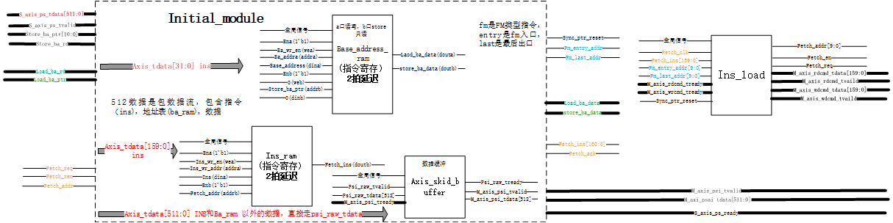

# AI月报
    
本月使用ai主要投入到3个部分：
（1）vpx640_acc加速器项目移植学习；
（2）一生一芯C阶段-PA3推进；
（3）FPGA大赛rk3576端开发；

## AI加速器
本月主要的token消费在此，主要针对两个模块进行了学习（initial_top和store_top).我使用vivso和ai分析对这两个模块之间的信号关系进行了梳理。

**initial_top（PS 包解析与指令分发）**：作为 AXIS 从机接收主机 512b 包流，靠包头带内自定界（无 tlast）。INS 指令逐条写入 ins_ram，基地址表写入 ba_ram，PARAM/FM 净荷经 psi 通道直通转发。内部 ins_load 完成取指循环：按 rw_flag 将指令分流为读/写两路，credit 流控；fm_entry/fm_last 双指针实现每帧重入——权重常驻 DDR，后续帧仅重传输入特征图。
**store_top（结果收集与 DDR 写回）**：汇聚 psi 数据与 cal_top 三路计算结果（激活/池化/残差），按写指令查 BA 表翻译出 32bit DDR 基址，再按行列 tile 二维寻址展开成二级写命令 {addr, bytes}，连同 512b 数据交 DMA 写回 DDR。store_fm_done 作为层间闸门，保证本层结果落盘后下层才启动读取；循环 padding 数据回灌 cal_top 复用。
上述两个模块全部通过axis协议交流，initial_top最为关键，他直接接受主机的ps包，然后进行指令分发，然后有一个特殊设计，就是ba_ram，它可以自由配置11bit和32位ddr真实地址的映射关系，让加速器具有了很高灵活性。

## 一生一芯项目
该部分工作主要在个人电脑上进行，推进内容是pa3-异常响应机制，pa3-用户程序和系统调用，pa3-简易文件程序（一切皆文件部分）。该部分ai主要作用是提供思路。pa3主要涉及到操作系统的开发。ai主要对ecall自陷指令到异常处理的全过程进行了逻辑调用梳理。（个人飞书学习记录表：https://fa45epzd9c7.feishu.cn/base/Z9V6bDJAuaOgr6sCfCxctbFunFh?table=blkMqxQF8KtiCEwL）

## fpga大赛
该部分基本全都是rk3576开发，个人不太熟悉liunx嵌入式开发，这部分个人工作仅仅包括github寻找带有完整权重文件的yolov8n模型和给ai提供完整的官方demo。然后剩下部分全部由ai自主开发。通过rknn工具链确认ai的工作没有问题。后续我将加强这一块的学习，课题组于ai加速器强相关，简单学习下yolo系列模型的具体结构。

## 其他
其他部分的ai使用主要集中在学校课程内容的解释上（听不懂的部分）。

## token消费
本月订阅了一个opencode go官方的coding plan,共67.46元。